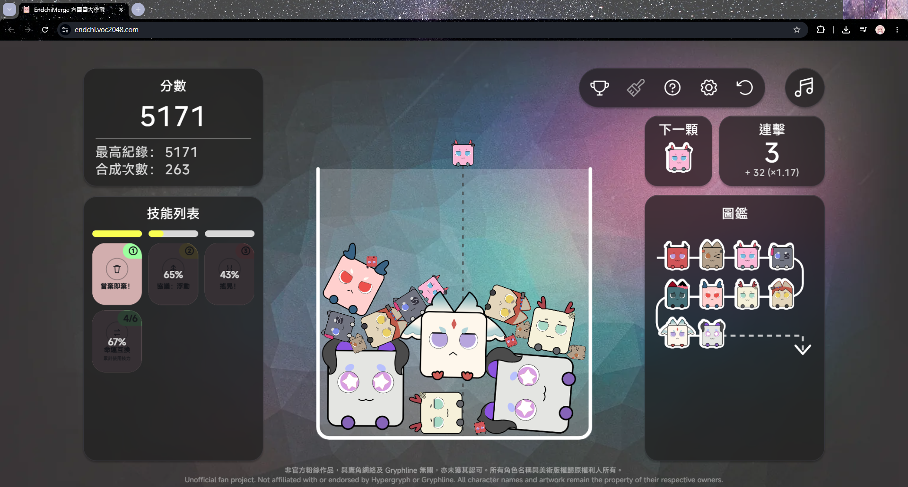
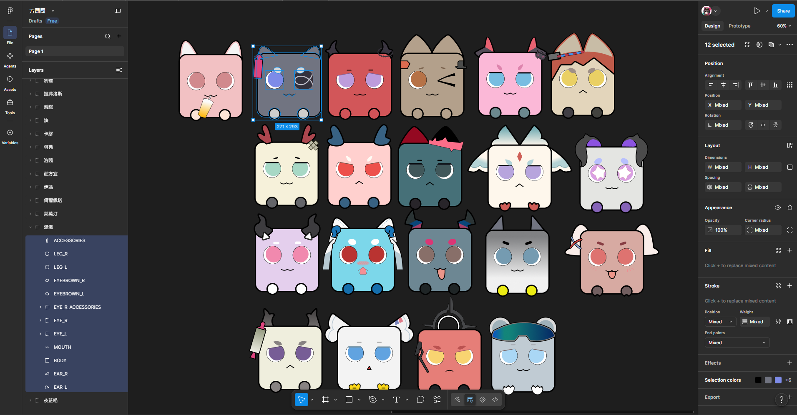

# EndchiMerge - 方團團大作戰

> *“Stack two identical Endchi together and they reunite into a bigger one.”*<br>

[](https://opensource.org/licenses/MIT)
[](https://github.com/Essk/ai-contribution-level)


| <span style="color:#FF99CC">📢 Think it's fun? Share it with a friend!</span><br> | [Click to play](https://endchi.voc2048.com) [EdgeOne for CN](https://cn-endchi.voc2048.com) |
|-|-|
| <span style="color:#05C189">📧 Suggestions or bug reports</span><br>| [Tell us in an issue](https://github.com/Vocaloid2048/EndchiMerge/issues) |

## <span style="color:#C3D630"> 🚧 Please note
### This is an unofficial fan project
- EndchiMerge is an unofficial fan-made spin-off built on the gameplay of the "OrbiPom! MERGE!" web event from *Arknights: Endfield*.
- The inspiration and the gameplay are drawn from that event.
- This project is **completely free** and will never be monetised in any form, including in-app purchases or ads.

### On data collection
- We do not collect any personally identifiable information.
- That said, if we detect suspicious behaviour (cheating, abuse), we may block that IP address from all future access.

### AI usage statement
- In this project the dumplings are entirely hand-drawn; AI agents were used to generate the code and part of the documentation.


### Copyright
Please note: this project is not affiliated with Hypergryph or Gryphline. *EndchiMerge* is simply a web game made by a fan; the assets used in it were created by 夜芷冰 (Vocaloid2048) and community contributors, and all character names and related artwork remain the property of their respective rights holders. The copyright of this project's source code belongs to 夜芷冰.

This project is completely free, with no in-app purchases and no ads, and is not monetised in any form. Without 夜芷冰's consent, the “方團團” (Endchi) assets may not be used for commercial profit or for any purpose that damages the reputation of any party (for assets contributed by other community members, please obtain their consent first).

## <span style="color:#569CD6">🗂️ Game menu</span>

The site opens on a menu: one tile per game (art above, name below). Press a tile to enter; the back button at the game's top-left corner returns here.

- `?game=merge` opens EndchiMerge directly; no parameter means the menu. Switching always reloads — the level table, the physics world and the leaderboard token are built only at the moment a game is entered.
- Backing out of a started run (at least one drop) asks first, with the confirm button locked for five seconds; a run with no drop leaves at once. Cancelling stays in the run with its state intact.
- Games that are not out yet (City Blocks, Match Three) are marked "Coming soon" and disabled on the menu.
- Adding a game means one row in `src/game/gameCatalog.ts` plus one boot branch in `src/main.ts`; see `docs/menu.md`.

## <span style="color:#569CD6">🎮 How to play</span>
Click the dumpling hanging above or press Space to drop it! When two identical dumplings touch, they merge into the next level — the goal is to unlock higher levels and rack up a higher score.

Merging on consecutive drops builds up a COMBO score bonus. The bonus accumulates until a single drop fails to trigger a COMBO, at which point it resets.

Make good use of the skills with different effects to push your score higher; you earn SP (skill points) from combos and from dropping dumplings, and SP can be traded for specific skills.

If the stack grows too tall and crosses the warning line, you have 5 seconds to clear it — time out and the run is over.

## <span style="color:#569CD6">🧩 Merge chain / codex</span>

| Level | Character | Level | Character |
|:--:|:--|:--:|:--|
| 1 | 萊萬汀 | 6 | 莊方宜 |
| 2 | 潔爾佩塔 | 7 | 弭弗 |
| 3 | 伊馮 | 8 | 卡繆 |
| 4 | 湯湯 | 9 | 訣 |
| 5 | 洛茜 | 10 | 梨諾 |


## <span style="color:#569CD6">⚡ SP and skills</span>
| Skill | Effect | Cost |
|:--|:--|:--:|
| 當棄即棄！ (Cast Off) | Pick one dumpling in the container and remove it; the dumplings above fall into the gap | 1 |
| 協議：浮動 (Protocol: Levitate) | Lift **all** dumplings upward for a while (greatly increasing merge chances); they stop at an invisible plane just below the warning zone | 2 |
| 搖晃！ (Shake Up!) | Shake the whole container side to side like an earthquake to loosen jammed dumplings | 3 |
| 命運互換 (Fated Exchange) | Pick **two** dumplings, swap their positions and stir the physics around them | \* |

> \* Unlock condition: unlocks once you have **spent 6 SP in total**, and using it resets that running total, and so on.

> The skill table is defined in JSON too — the number of skills is not hard-coded, and the SP cap defaults to 3 (settable to any integer from 1 to 10).
> A skill is charged only when its effect **actually runs**: nothing is charged while picking, and cancelling refunds nothing. **Dropping is
> blocked** while a skill is active (including while a target is being picked).

## 🤔 Why this exists
After finishing that web event I still wanted more — it felt like it was missing a bit of fun. I wondered whether adding some new skills, settings and characters would make it more enjoyable.

I had also just started trying to learn how to use AI agents (and I was not very familiar with web game development), so I planned to have an agent complete the whole project on its own from my requirements (though I later found I was overthinking it). In the end I spent half a day referencing the official 山團團 and then built each dumpling myself with my own ideas on top (which is why they look almost the same?).

I then spent a few more days going back and forth with the agent while fixing up the source code (so the code is mostly written by the agent, but I hand-modelled every dumpling myself, one at a time).

I hope that when I have more free time later I can slowly add more fun gameplay and characters (a full codex?), and collaboration through PRs is very welcome! I am also curious whether the community's mainstream view of AI-collaboration output is still mostly rejection…

Either way, I hope you have fun playing!

## 💻 Running locally
<details>
Node.js 22 or newer is recommended.

```bash
# 1. Clone the repo
git clone https://github.com/Vocaloid2048/EndchiMerge.git

# 2. Enter the directory
cd EndchiMerge

# 3. Install dependencies
npm install

# 4. Start the dev server (front end + back end + database, one command)
npm run dev
```

Other commands:

```bash
npm run build      # typecheck + bundle
npm run preview    # preview the production build
npm run typecheck  # typecheck only
npm test           # run tests (Vitest, once; includes real SQL against an in-memory database)
npm run test:watch # tests in watch mode
npm run dev:web    # front end only (pure UI work; the API is not reachable)
npm run db:migrate # create the tables in whatever DATABASE_URL names (all three dialects supported)
```
</details>

### Contributors
<a href="https://github.com/Vocaloid2048/EndchiMerge/graphs/contributors">
  
</a>

---

## <span style="color:#569CD6">🎵 Music credit</span>

The in-game background music is **Take A Walk** by Hotham. With thanks to the artist.

- **Music**: Take A Walk by Hotham — https://soundcloud.com/hothammusic
- **License**: Creative Commons — Attribution 3.0 Unported — CC BY 3.0
- **Free Download / Stream**: https://links.al/elY
- **Music promoted by Audio Library**: https://links.al/youtube

---

[繁體中文版](README.md)
